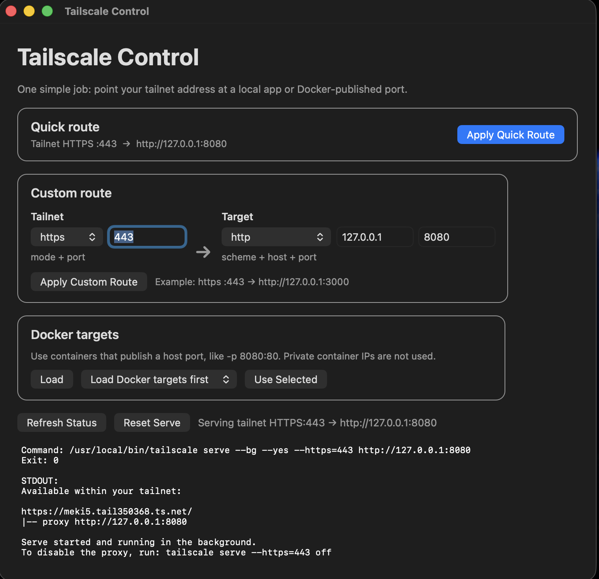

# Tailscale Control

Tailscale Control is an unofficial native macOS utility for configuring [`tailscale serve`](https://tailscale.com/kb/1242/tailscale-serve) routes to local apps and Docker-published ports.

It is intentionally small: it validates input, runs the local `tailscale` and `docker` CLIs with explicit argument arrays, and shows command output in the app.

This is free and open-source software (MIT) for everyone. There is no vendor, no account, no telemetry, and no branding — just a local utility you can read, build, and modify.

> This project is not affiliated with, endorsed by, or sponsored by Tailscale Inc. Tailscale is a trademark of Tailscale Inc.

## Screenshot



## Features

- Native macOS Swift/AppKit app; no web runtime or Electron.
- Quick route: `HTTPS :443` on your tailnet to `http://127.0.0.1:8080`.
- Custom routes: choose tailnet mode/port and local target scheme/host/port.
- Docker target discovery for containers with published host ports.
- Status and reset controls for `tailscale serve`.
- Closes like a normal small utility: closing the main window quits the app.

## Requirements

Runtime:

- macOS 13 or newer.
- Tailscale CLI installed and logged in.
- Docker CLI installed only if you want Docker target discovery.

Build from source:

- macOS with Xcode Command Line Tools.
- `swiftc`, `codesign`, `plutil`, and `hdiutil` available in PATH.

## Download a DMG from Releases

For normal installation, download the latest `.dmg` from the project's GitHub Releases page:

1. Open the repository on GitHub.
2. Go to **Releases**.
3. Download `Tailscale-Control-<version>.dmg`.
4. Open the DMG and drag **Tailscale Control.app** to **Applications**.
5. Launch the app from Applications.

The GitHub release workflow in this repository builds the DMG on macOS runners when a version tag is pushed.

## Build locally

```bash
git clone <repository-url>
cd tailscale-control
make build
open "build/Tailscale Control.app"
```

Run verification:

```bash
make verify
```

Create a local DMG:

```bash
make dmg
```

The DMG will be written to `dist/`.

## Release process for maintainers

1. Update version notes if needed.
2. Tag the release:

   ```bash
   git tag v0.1.0
   git push origin v0.1.0
   ```

3. GitHub Actions builds the app and uploads:
   - `Tailscale-Control-v0.1.0.dmg`
   - the generated `.app` artifact

## How routing works

The app configures Tailscale Serve. For example, the quick route runs:

```bash
tailscale serve --bg --yes --https=443 http://127.0.0.1:8080
```

That means:

```text
tailnet HTTPS :443 -> http://127.0.0.1:8080
```

For Docker on macOS, publish the container port to the host first:

```bash
docker run -p 8080:80 your-image
```

Then route Tailscale to:

```text
http://127.0.0.1:8080
```

The app does not route to Docker private container IPs. On Docker Desktop for macOS, host-published ports are the reliable path.

## Project layout

```text
Sources/TailscaleControl/main.swift   Native app source
scripts/build.sh                      Build and ad-hoc sign the .app
scripts/package-dmg.sh                Create a local DMG
.github/workflows/release.yml         CI/release build workflow
Makefile                              Convenience commands
LICENSE                               MIT License
```

## Development notes

- Commands are executed without shell interpolation.
- Port, host, scheme, and mode inputs are validated before command execution.
- The `--self-test` mode verifies command construction without changing live Tailscale configuration.
- The `--close-self-test` mode verifies that closing the window terminates the app process.

## License

MIT. See [LICENSE](LICENSE).
