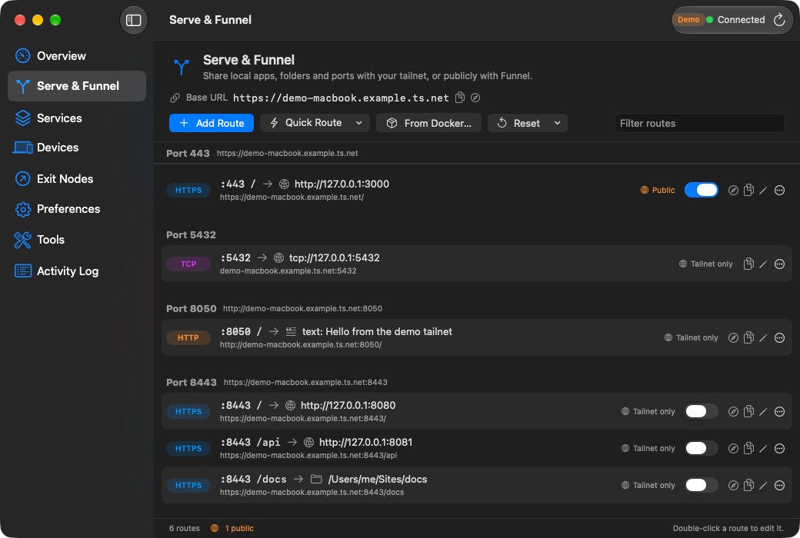
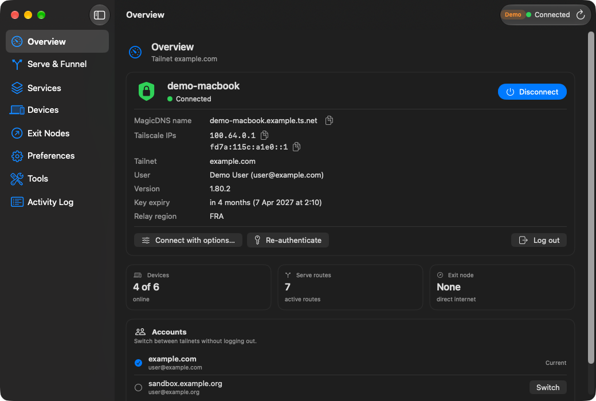
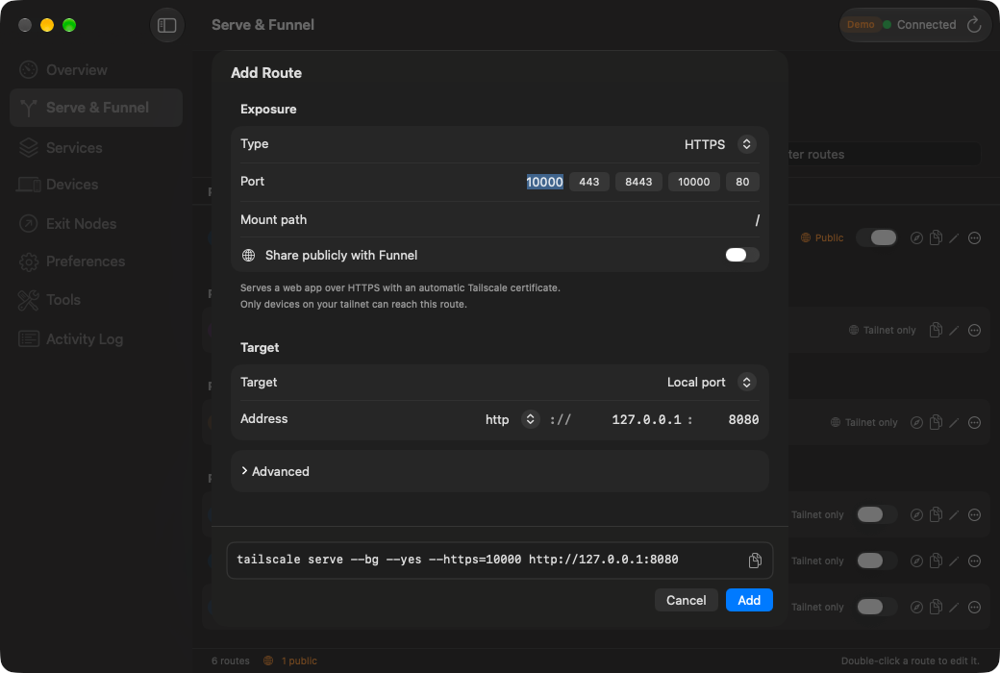
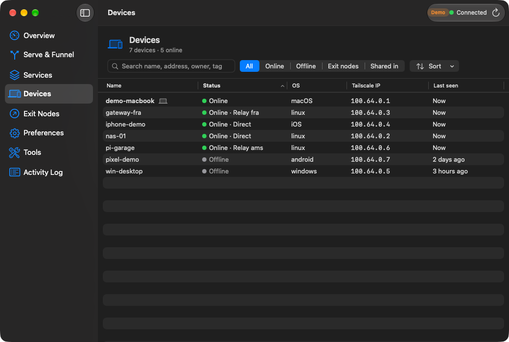
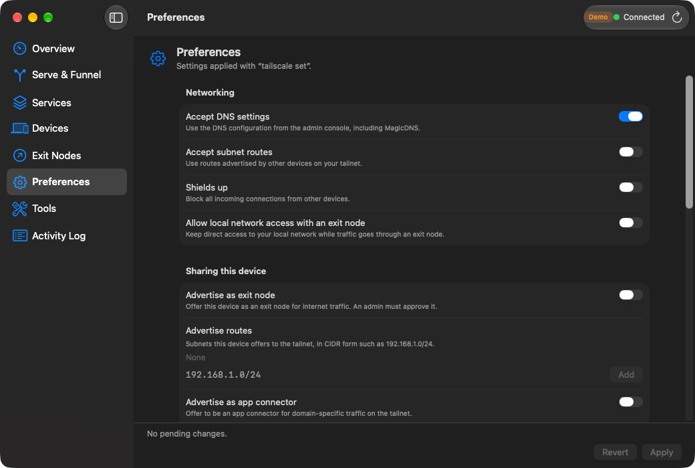
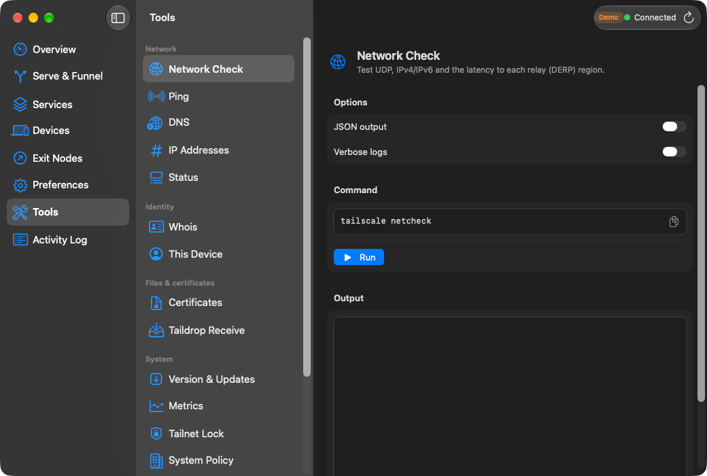

# Tailscale Control

Tailscale Control is an unofficial, native macOS app for managing a local [Tailscale](https://tailscale.com) node. It puts the everyday parts of the `tailscale` command line into a window and a menu bar item: connection state, Serve and Funnel routes, Tailscale Services, devices, exit nodes, preferences and diagnostics.

It does not replace the Tailscale client. It runs the `tailscale` command that is already installed on your Mac, shows you the exact command before it runs, and logs everything it did.

It is free and open-source software (MIT). There is no account, no vendor service and no telemetry.

> This project is not affiliated with, endorsed by, or sponsored by Tailscale Inc. Tailscale is a trademark of Tailscale Inc.



The screenshots in this repository are taken in [demo mode](#demo-mode) and show fictional data only.

## Features

**Overview.** Connection state, this device's MagicDNS name, Tailscale IPs, tailnet, user, version and key expiry. Connect, disconnect, re-authenticate or log out; "Connect with options" builds a `tailscale up` command from checkboxes and shows it first. When a sign-in is needed, the login link is shown and can be opened or copied. Switch between accounts without logging out.



**Serve & Funnel.** A native editor for every serve route of this node: HTTPS, HTTP, TCP and TLS-terminated TCP; mount paths; proxy, file/folder and text targets; and Funnel (public) exposure with a toggle per route. Add routes with a form, a quick-route menu, or from a running Docker container's published port. Routes are grouped by port and show their public URL. The generated command is previewed before you apply it.



**Services.** Tailscale Services (`svc:` names) hosted by this node: their routes, drain, advertise and clear, plus export and import of service configuration files.

**Devices.** A sortable, searchable table of the tailnet with an inspector for the selected device: addresses, connection path, key expiry, advertised routes and capabilities. From the inspector you can ping, run whois, send files with Taildrop, and copy SSH commands.



**Exit Nodes.** See the current exit node, pick another one (with the "suggest" helper), allow LAN access while using one, or offer this device as an exit node.

**Preferences.** The settings of `tailscale set` as switches and fields: DNS, subnet routes, shields up, SSH, advertised routes, hostname, auto-update and more. Changes are applied together; risky ones ask for confirmation first.



**Tools.** Forms for the rest of the command line: network check, ping (several kinds), DNS, IP addresses, status, whois, certificates, Taildrop receive, version and update check (dry run only), metrics, Tailnet Lock, system policy, licenses, bug report and the web interface. A custom-command box runs any other `tailscale` command; anything not known to be read-only asks for confirmation. Output streams live and can be stopped.



**Activity Log.** Every command the app runs on your behalf, with exit status, duration and output. Filter, copy, or export it. Secrets such as auth keys are masked.

**Menu bar.** Connect or disconnect, choose an exit node, copy your IP or DNS name, and jump to a section. The menu bar icon can be turned off in Settings (⌘,); the window then behaves like a normal app and quits when closed.

Keyboard: ⌘1 to ⌘8 switch sections, ⌘R refreshes, ⌘, opens Settings.

## Requirements

- macOS 13 (Ventura) or newer, Apple silicon or Intel.
- Tailscale installed and signed in. The app looks for the `tailscale` command in `/usr/local/bin`, `/opt/homebrew/bin`, `/usr/bin` and inside `/Applications/Tailscale.app`. You can choose another path in Settings.
- Docker is optional and only used to list published container ports when you ask for it.

## Install from the DMG

1. Download `Tailscale-Control-<version>.dmg` from the repository's **Releases** page.
2. Open it and drag **Tailscale Control** to **Applications**.
3. Start it from Applications.

The app is signed ad hoc, not with a paid Developer ID certificate, and is not notarized. The first time you open it, macOS Gatekeeper may say it cannot verify the developer. To open it anyway:

- Control-click (or right-click) the app, choose **Open**, then **Open** again; or
- open **System Settings > Privacy & Security** and click **Open Anyway** next to the message about Tailscale Control; or
- remove the quarantine flag in Terminal: `xattr -dr com.apple.quarantine "/Applications/Tailscale Control.app"`.

If you would rather not trust a binary, build it yourself; it is a short script.

## Build from source

You need the Xcode Command Line Tools (`xcode-select --install`); full Xcode is not required. The build uses plain `swiftc`, there is no Xcode project or package manager.

```bash
git clone <repository-url>
cd tailscale-control
make build                       # build and ad-hoc sign "build/Tailscale Control.app"
open "build/Tailscale Control.app"
```

Other targets:

```bash
make typecheck   # fast type-check of all sources
make test        # build, run the self-tests and the window smoke test
make verify      # test, then lint Info.plist and verify the code signature
make dmg         # verify, then write dist/Tailscale-Control-<version>.dmg
make clean
```

If `swiftc` complains that the Xcode license has not been accepted, or cannot find a toolchain, but the Command Line Tools are installed, point the build at them:

```bash
export DEVELOPER_DIR=/Library/Developer/CommandLineTools
make build
```

`scripts/build.sh` already falls back to the Command Line Tools when the `swiftc` on your `PATH` does not run. Set `SWIFTC` to force a specific compiler. The version comes from the `VERSION` file (override with the `VERSION` environment variable). The app icon is drawn by `scripts/make-icon.swift` during the build and cached under `build/icon/`; if that step fails the app is built without an icon.

## How commands are executed

The app is a thin layer over the `tailscale` command, so how it runs commands matters:

- **Argument arrays, no shell.** Every command is built as a list of arguments and started directly. Nothing is passed through `sh -c`, so quotes, `;`, `$()` and similar in a value are just characters. The custom-command box splits quotes and backslashes the way a shell would, but never expands variables, globs or pipes.
- **Validated input.** Ports, hosts, schemes, mount paths, service names and similar fields are checked before a command is built.
- **Command preview.** Forms show the exact `tailscale ...` command that will run, ready to copy.
- **Confirmation for destructive actions.** Resetting serve or funnel, removing routes, logging out, writing certificates, replacing service configuration and custom commands that are not on a read-only list ask first.
- **Secrets are masked.** Values of `--auth-key`, `--client-secret` and `--id-token` are replaced with `REDACTED` in previews and in the Activity Log.
- **Reads are separate from writes.** Refreshing status, routes and preferences only runs read-only commands (`status --json`, `serve status --json`, `get --json`, `switch --list`, `version`). Only buttons you press run commands that change something.
- **Everything is logged.** Commands you run appear in the Activity Log with their output.

A few features call Tailscale only when you invoke them: Bug Report (`tailscale bugreport`), Funnel (public exposure of a route), and certificates (`tailscale cert`, which contacts the certificate authority through Tailscale). The app itself makes no network requests.

## Demo mode

`--demo` starts the app with built-in fictional data: a small tailnet with devices of mixed operating systems, an exit node, a set of Serve and Funnel routes, two accounts and a few Docker containers. **No process is ever started** and no `tailscale` or `docker` binary is looked up. Actions that change something are simulated: they appear in the Activity Log with the output `(demo — not executed)`, and where it is simple they change the in-memory data (add, edit or remove a route, connect or disconnect, toggle preferences, choose an exit node). A "Demo" badge in the toolbar shows that the data is not real.

```bash
"build/Tailscale Control.app/Contents/MacOS/Tailscale Control" --demo
```

Demo mode is how the screenshots in `docs/screenshots/` are made, and it is a safe way to try the app without a Tailscale node.

## Launch arguments

| Argument | Effect |
| --- | --- |
| `--demo` | Fictional data, nothing is executed (see above). |
| `--section=<name>` | Open a section: `overview`, `serve`, `services`, `devices`, `exitNodes`, `preferences`, `tools`, `activity`. |
| `--show=add-route` | Open the Serve route editor on launch. |
| `--show=connect-options` | Open Overview's "Connect with options" sheet on launch. |
| `--self-test` | Run the self-tests (command builders, parsers, demo backend) and exit with 0 on success. |
| `--close-self-test` | Open the window, check that it appeared, and exit. |

`--section` and `--show` exist for documentation screenshots; combine them with `--demo`.

## Project layout

```text
Sources/TailscaleControl/App/    App entry point, main window, sidebar, launch arguments
Sources/TailscaleControl/Core/   Command runner, tailscale CLI wrapper, models, parsers, store, demo backend, self-tests
Sources/TailscaleControl/UI/     SwiftUI views for each section and shared components
scripts/build.sh                 Build, bundle, icon and ad-hoc signing
scripts/make-icon.swift          Draws the app icon with CoreGraphics
scripts/package-dmg.sh           Create dist/Tailscale-Control-<version>.dmg
docs/screenshots/                Screenshots (demo mode)
VERSION                          App version
Makefile                         Convenience targets
.github/workflows/release.yml    CI build and release
```

## Documentation

- [CHANGELOG.md](CHANGELOG.md)
- [CONTRIBUTING.md](CONTRIBUTING.md)
- [PRIVACY.md](PRIVACY.md)
- [SECURITY.md](SECURITY.md)
- [RELEASE.md](RELEASE.md)

## License

MIT. See [LICENSE](LICENSE).
